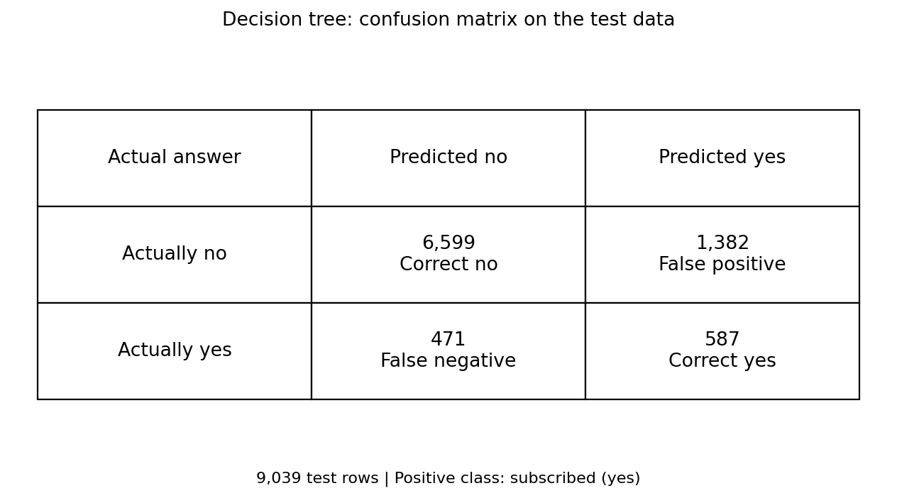
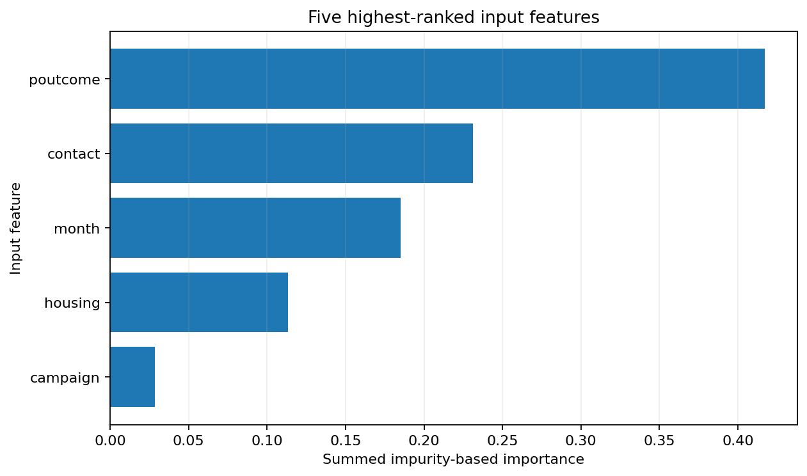
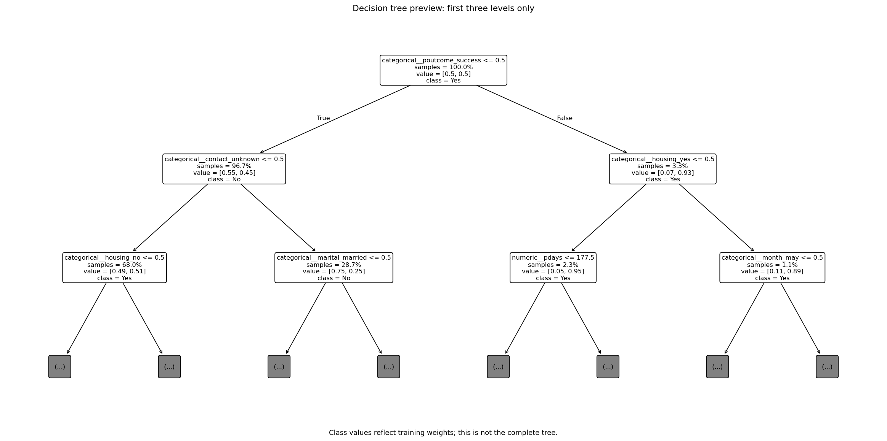

# Bank Marketing: Decision Tree Classifier
**Maryam Chaudhry | ArithMatrix AVIP 2026 | Data Science Task 4**

## Project question
Can a decision tree classify whether a customer subscribed to a term deposit, using recorded customer and campaign information? The target is `y`: no = 0, yes = 1. This is an educational analysis, not a loan-approval or production marketing system.

## Data source and attribution
[UCI Bank Marketing dataset](https://archive.ics.uci.edu/dataset/222/bank+marketing). Selected file: **bank-full.csv**.
Moro, S., Rita, P., & Cortez, P. (2014). Bank Marketing [Dataset]. UCI Machine Learning Repository. https://doi.org/10.24432/C5K306.
Dataset licence listed by UCI: [CC BY 4.0](https://creativecommons.org/licenses/by/4.0/).
The saved CSV is the original source snapshot. Prepared rows are changed only as documented below.
Original download time (UTC): **2026-09-29T19:34:30.070870+00:00**.
Source rows: **45,211**. Retained model rows: **45,195**.
The matching fingerprint and download address are in `data/source_metadata.json`.

## Run the notebook
Open `Bank_Marketing_Decision_Tree_Task_4.ipynb` in Google Colab or Jupyter. Run the code cells from top to bottom. The installation cell installs the packages; the download cell reads the selected UCI CSV. An internet connection is needed for a fresh download.

To reproduce with the saved data, make `data/source_bank_full.csv` and `data/source_metadata.json` available in the notebook runtime. Change `LOCAL_CSV` and `LOCAL_METADATA` in Section 2 to their actual paths. Leave both as `None` to download again. The loader checks that the saved CSV matches its metadata.

For a local Jupyter environment, install the saved package versions with:

```bash
python -m pip install -r requirements.txt
```

The notebook contains the explanations, data preparation, model training and evaluation code. The ZIP export contains results and supporting files, not a second copy of the notebook. Run metadata includes the Python and package versions; matching versions and source data improves reproducibility.

## Preparation and model
Call `duration` is excluded because its final value would not be available before a call ends. The target `y` is also excluded from inputs.

Text is tidied, invalid target rows are removed, and exact duplicates across the selected inputs and target are removed before splitting. `unknown` stays a category. Negative balances and `pdays=-1` are not treated as missing. The latter marks no previous-campaign contact. All changes are recorded in `data/cleaning_audit.json`.

There are **36,156 training rows** and **9,039 test rows**, with a stratified 80%/20% random row split and seed 42. Training-only medians fill missing numeric values. Missing categories receive a `missing` label; one-hot encoding handles categorical inputs and tolerates unseen test categories. These transformations are fitted within the pipeline using training rows only.

The classifier uses `max_depth=5`, `min_samples_leaf=50` and `class_weight='balanced'`. These are fixed starting settings, not test-selected optimum values. Class weighting changes training weights, not row counts. The majority baseline always predicts the most common training outcome.

## Test results
Precision and recall use subscription (yes = 1) as the positive class. Undefined precision is recorded as zero when no yes predictions are made; the predicted-yes count is in `metrics.json`.

| Measure | Decision tree | Majority baseline |
|---|---:|---:|
| Test accuracy | 79.50% | 88.30% |
| Precision (yes) | 29.81% | 0.00% |
| Recall (yes) | 55.48% | 0.00% |

Training accuracy: **79.77%**.



## Top five input features
Importance scores measure the tree's training split usage, summed over one-hot columns belonging to the same original feature. They are not causal effects and can favour inputs with many possible split values.

| Input feature | Importance |
|---|---:|
| poutcome | 0.4170 |
| contact | 0.2314 |
| month | 0.1850 |
| housing | 0.1132 |
| campaign | 0.0283 |



## Tree preview
Only the first three levels are displayed. Class values reflect training weights, not raw customer counts.



## Model summary
The decision tree was trained on 36,156 rows and tested on 9,039 held-out rows. Test accuracy was 79.50%, compared with 88.30% for the majority-class baseline. For subscribers (yes), precision was 29.81% and recall was 55.48%. The tree identified 587 actual subscribers, missed 471, and incorrectly predicted yes for 1,382 non-subscribers. These counts show why accuracy must be considered alongside precision and recall.

The five highest-ranked inputs were poutcome, contact, month, housing, campaign, using summed training-tree importance scores. These scores describe model usage, not causes of subscription. Call duration was excluded because its final value is unavailable before a call ends. Preparation was fitted only on training data. A limited tree depth and minimum leaf size controlled complexity; the settings were not selected using test scores. This is a retrospective random-row evaluation of historical data, not proof of performance on future campaigns or different customers. Class weighting can trade more identified subscribers for more incorrect yes predictions. The model is an educational prototype, not ready for customer decisions.

## Limitations and responsible use
This is a random-row, historical evaluation, not an out-of-time test. There is no identifier to guarantee that customers in the test data are absent from training. Some recorded fields describe the latest contact; their availability must be checked for any intended prediction time. Removing duration alone is not a complete deployment audit.

Results depend on this dataset, split, software and model settings. No real marketing costs or subgroup fairness tests are included. Demographic inputs may create unfair patterns, so this prototype should not make decisions about real customers. Scores do not establish causation, suitability for deployment or future performance. Further tuning should use validation inside the training data, not repeated choices based on this test set.

## Project files
- `Bank_Marketing_Decision_Tree_Task_4.ipynb`: explanations, preparation, training and evaluation code, saved separately.
- `charts/`: confusion matrix, top-five feature chart and optional tree preview.
- `metrics.json`: test scores, baseline scores and confusion-matrix counts.
- `model_summary.md`: interpretation of the measured results.
- `model_settings.json`: model choices, random seed and run software versions.
- `feature_importances.csv`: full ranking of original input features.
- `encoded_feature_importances.csv`: individual encoded-column scores.
- `test_predictions.csv`: row numbers and actual/predicted labels, no customer names.
- `data/`: source CSV, source details, cleaning audit and train/test row numbers.
- `requirements.txt`: package versions used in this run.

## AI assistance
This project was prepared with AI assistance. The code calculates its scores from the cited data. AI-generated explanations do not replace checking the calculations and limitations.

## Technical references
- [Avoiding data leakage](https://scikit-learn.org/stable/common_pitfalls.html#data-leakage)
- [DecisionTreeClassifier](https://scikit-learn.org/stable/modules/generated/sklearn.tree.DecisionTreeClassifier.html)
- [OneHotEncoder](https://scikit-learn.org/stable/modules/generated/sklearn.preprocessing.OneHotEncoder.html)
- [Precision](https://scikit-learn.org/stable/modules/generated/sklearn.metrics.precision_score.html)
- [Recall](https://scikit-learn.org/stable/modules/generated/sklearn.metrics.recall_score.html)
- [DummyClassifier baseline](https://scikit-learn.org/stable/modules/generated/sklearn.dummy.DummyClassifier.html)
